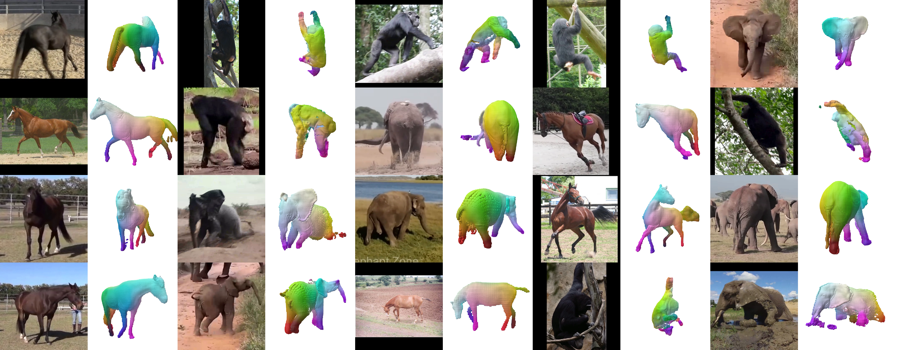

# _BAT3R_: Bootstrapping Articulated 3D Reconstruction from 2D Image Collections (ECCV 2026)

[Jakub Zadrożny](https://jakubzadrozny.github.io/), 
[Oisin Mac Aodha](https://homepages.inf.ed.ac.uk/omacaod), 
[Hakan Bilen](https://homepages.inf.ed.ac.uk/hbilen) | 
University of Edinburgh | **[🔗 Project Page](https://jakubzadrozny.github.io/bat3r/)** | 
**[📝 Paper](https://arxiv.org/abs/2607.03891)**



This is the official implementation of **_[BAT3R](https://jakubzadrozny.github.io/bat3r/)_** using [PyTorch](https://pytorch.org/).

## 🛠️ Installation

> **Note:** A CUDA-capable GPU is only required for training with online point map rasterization (`dualpm_lib` / `nvdiffrast`). Inference does not require CUDA.

We recommend using [Anaconda](https://www.anaconda.com/) to set up a Python environment.

Create and activate a virtual environment:
```bash
conda create -n bat3r python=3.10 -y
conda activate bat3r
```

Install BAT3R in editable mode:
```bash
pip install -e .
```

### Blender Rendering Dependencies
For synthetic data rendering (`scripts/rendering/`), install `pyyaml` and `tqdm` into Blender's bundled Python interpreter (**Blender 4.5 LTS** recommended):
```bash
/path/to/blender/4.5/python/bin/python3.11 -m pip install --no-user pyyaml tqdm
```

## 📦 Pretrained Models & Assets

Pretrained checkpoints, category SD-DINO PCAs, dataset split manifests, and synthesized horse coat textures are hosted on Hugging Face Hub at **[`jzadrozny/bat3r`](https://huggingface.co/jzadrozny/bat3r)**.

Install the Hugging Face CLI (`pip install -U huggingface_hub`) and download the bundle into `assets/`:
```bash
hf download jzadrozny/bat3r --local-dir assets
```
*(To fetch only a single checkpoint, e.g. Horse: `hf download jzadrozny/bat3r --include "checkpoints/horse_real.pth" --local-dir assets`.)*

This populates:
- `assets/checkpoints/`:
  - Main real-world models: `horse_real.pth`, `chimp_real.pth`, `elephant_real.pth`
  - Stage 1 canonical initializations: `horse_canon.pth`, `chimp_canon.pth`, `elephant_canon.pth`
  - Synthetic-benchmark Horse model: `horse_synt.pth`
- `assets/pcas/`: `horse.faiss` *(identical to `dualpm_features/libs/horse_male_pca.faiss`)*, `chimp.faiss`, `elephant.faiss`
- `assets/split_manifests/`: `chimp_split_manifest.json`, `elephant_split_manifest.json`
- `assets/textures/horse_{male,female}-rd/`: synthesized horse textures

> Third-party 3D meshes and Poly Haven HDRIs are not redistributed; see [scripts/dataset_prep/README.md](scripts/dataset_prep/README.md) to build `<category>.blend` scenes with `scripts/rendering/prepare_blend.py` and download HDRIs with `scripts/rendering/download_hdrs.py`.

## 🧑‍🍳 Data Preparation

Organize each category dataset as follows:
```
data/
└── <category>/
    ├── images/
    │   ├── 000000_rgb.png
    │   └── ...
    ├── masks/
    │   ├── 000000_mask.png
    │   └── ...
    ├── features/
    │   ├── 000000_feat.png
    │   └── ...
    ├── train_ids.json
    ├── test_ids.json
    └── shapes/
        └── <shape_id>/
            ├── <shape_id>_shape.gltf
            ├── <shape_id>_shape.bin
            └── <shape_id>_geo_dists.npz
```

For full instructions on reproducing our **Horse**, **Chimp**, and **Elephant** datasets, onboarding a **new category**, precomputing geodesic distances, and extracting SD-DINO features, see [scripts/dataset_prep/README.md](scripts/dataset_prep/README.md).

## 🧠 Run Evaluation

To run quantitative 3D evaluation on a dataset with ground-truth 3D poses/cameras (e.g., the DualPM synthetic test set or a rendered synthetic dataset):
```bash
python scripts/infer.py \
  category=horse \
  split=test \
  log_dir=assets/checkpoints \
  ckpt_name=horse_real.pth \
  dataset_root=/path/to/eval_dataset \
  output_dir=outputs/eval_horse
```
Per-sample 3D metrics are written as `<ckpt_stem>.csv` (or `<ckpt_stem>-train.csv` for `split=train`) inside `output_dir` (defaults to `log_dir` if `output_dir` is omitted; setting `output_dir` keeps `assets/checkpoints/` clean and avoids clashes across datasets).

## 🚀 Train Your Own Model

Copy [scripts/launcher/example.env](scripts/launcher/example.env) and set your paths:
- `DATASET_PATH`: prepared real-world category dataset (`data/<category>`)
- `MODELS_ROOT`: base directory for all experiment `log_dir`s (each experiment stores both checkpoints and per-iteration rendered synthetic datasets here)
- `PCA_PATH`: category PCA file (e.g. `assets/pcas/horse.faiss`)
- `RENDER_ASSETS_DIR`: directory containing `<category>.blend`, `hdrs/`, and optional `textures/` (e.g. `assets`)

Then run Stage 1 (canonical initialization) followed by Stage 2 (iterative bootstrapping):
```bash
cp scripts/launcher/example.env my_horse.env
bash scripts/launcher/train_canonical.sh my_horse.env
bash scripts/launcher/train_bootstrap.sh my_horse.env
```
*(You can skip Stage 1 by setting `INITIAL_MODEL="assets/checkpoints/<cat>_canon.pth"` in your `.env` file.)*

Each launcher creates a self-contained experiment tree under `MODELS_ROOT`:
```text
<MODELS_ROOT>/<EXP_NAME>/
├── run.env, main.yaml, infer.yaml, real.yaml, <category>.yaml
├── <EXP_NAME>_0/
│   └── output/                # Stage 1 canonical (or Iter 1 bootstrapped) rendered dataset
├── <EXP_NAME>_1/
│   ├── weights_10000.pth ...  # Iter 1 checkpoints + Step 5 eval CSV
│   └── output/                # Iter 2 rendered dataset
└── ...
```

## 🏅 Acknowledgement

Our implementation builds upon [DualPM](https://dualpm.github.io/). We thank the authors for their open-source contributions.

## 📖 Citation

If you find this work useful for your research, please consider citing our paper:
```bibtex
@inproceedings{zadrozny2026bat3r,
  author    = {Zadro{\.z}ny, Jakub and Mac Aodha, Oisin and Bilen, Hakan},
  title     = {BAT3R: Bootstrapping Articulated 3D Reconstruction from 2D Image Collections},
  booktitle = {Proceedings of the European Conference on Computer Vision (ECCV)},
  year      = {2026}
}
```
